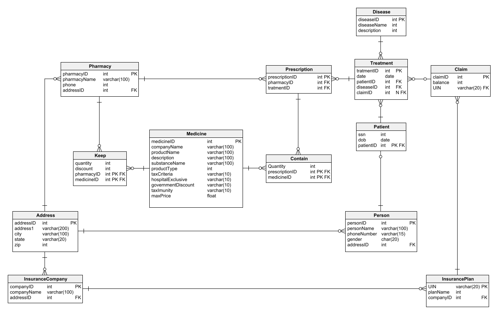

# Healthcare Database Management System – SQL Project

## Project Overview

This project focuses on analysing healthcare data using MySQL to solve five real-world business problems.

The analysis covers patients, diseases, pharmacies, prescriptions, insurance plans, treatments and insurance claims.

The objective is to use SQL queries to extract meaningful insights and support healthcare business decision-making.

## Database Schema

The database consists of 13 relational tables.

## Tools & Technologies

- MySQL
- MySQL Workbench
- SQL
- Relational Database Management

## Database Tables

1. Address
2. Person
3. Patient
4. Disease
5. InsuranceCompany
6. InsurancePlan
7. Claim
8. Treatment
9. Pharmacy
10. Prescription
11. Medicine
12. Keep
13. Contain

## Business Problems Solved

### Problem 1: Pharmacy Location Analysis

Identified the top 3 cities with the lowest pharmacy-to-prescription ratio, considering only cities with more than 100 prescriptions.

### Problem 2: Disease Analysis in Alabama

Identified the disease with the maximum number of treated patients in each city of Alabama (AL).

### Problem 3: Insurance Plan Analysis

Identified the most claimed and least claimed insurance plans for each disease.

### Problem 4: Household Disease Analysis

Identified the number of households having more than one patient diagnosed with the same disease. A household is identified using a common address.

### Problem 5: State-wise Treatment-to-Claim Ratio

Calculated the state-wise treatment-to-claim ratio for the financial year from 1 April 2021 to 31 March 2022.

## SQL Concepts Used

- SELECT and WHERE
- INNER JOIN and LEFT JOIN
- GROUP BY and HAVING
- Aggregate Functions (COUNT)
- Subqueries
- Common Table Expressions (CTEs)
- Window Functions (RANK)
- UNION ALL
- CREATE INDEX
- ORDER BY and LIMIT
- NULLIF and ROUND

## Project Files

| File | Description |
|---|---|
| SQL PROJECT.sql | SQL queries for all five business problems and database analysis |
| Healthcare-Schema.png | Healthcare database schema diagram |
| Project Healthcare2 problem statements.docx | Original project problem statements |

## Key Learning Outcomes

- Practised SQL queries on a relational healthcare database.
- Used joins to combine information from multiple tables.
- Applied aggregate functions to analyse healthcare data.
- Used CTEs and window functions for ranking and comparisons.
- Developed SQL-based solutions for business problems.

## Author

**Jusaina Sherin**

Aspiring Data Analyst | SQL | Excel | Power BI | Python | Tableau | Generative AI | Machine Learning

[GitHub](https://github.com/datawithsherin)
